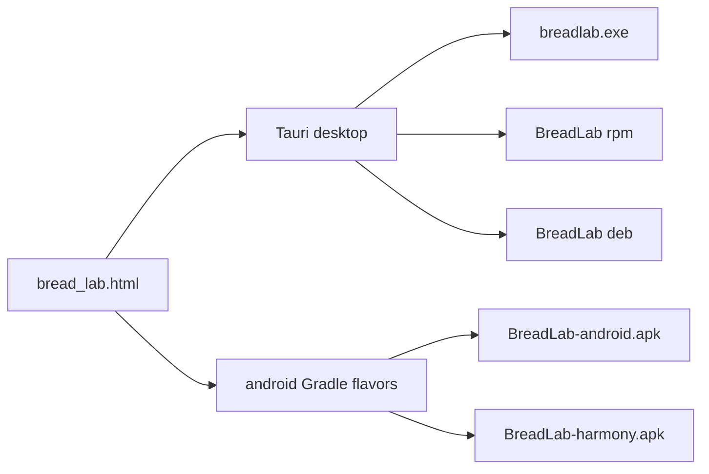

# BreadLab

Автономное русскоязычное приложение для подбора и масштабирования рецептов хлеба под **Panasonic SD-YR2540HTS** и **REDMOND SkyCooker RMC-M92S**.

Интернет и отдельный сервер не нужны. Справочник из 35 технологических карт, 54 ингредиентов и 9 добавок «по вкусу» лежит в репозитории и попадает в собранный файл. Расчёты (пекарские проценты, гидратация, масса теста, прогноз буханки, лимиты техники, подбор по кладовой) выполняются локально.

В репозитории три независимых дерева исходников:

| Дерево | Что из него получается |
|---|---|
| `src/` + `src-tauri/` | Настольное приложение Tauri 2: один `exe`, пакет `rpm`, пакет `deb` |
| `android/` | Два подписанных APK: Android и HarmonyOS с Android-совместимостью |
| `breadlab/` | Flutter-приложение `0.0.2`: свой Android APK и каркас HAP для HarmonyOS NEXT |

Ниже — как из исходников получить ровно один файл каждого запрошенного вида. Остальные разделы описывают устройство проекта, разработку и проверки.

## Сборка одного файла

Пять команд ниже независимы. Каждая печатает один артефакт и не требует остальных.

Общее для `exe`, `rpm` и `deb`:

- Node.js и npm (в корне есть `package-lock.json`);
- Rust stable, не ниже **1.90** (`rust-version` в `src-tauri/Cargo.toml`);
- из корня репозитория один раз: `npm install`.

`npm run tauri …` вызывает Tauri CLI 2.12. Перед сборкой CLI сам запускает `npm run build` (`tsc --noEmit` и production-сборка Vite в каталог `desktop-dist`). JSON-справочник вшивается в бинарник через `include_str!` в `src-tauri/src/models/mod.rs`. Отдельный HTML рядом с готовым файлом не нужен.

Версия настольных пакетов — **1.0.0** из `src-tauri/tauri.conf.json` (`productName`: `BreadLab`). В `bundle.targets` перечислены `deb`, `appimage`, `nsis`, `msi`. Цель `rpm` в этот список не входит: её включает флаг CLI, конфиг менять не нужно.

### exe — Windows

Собирается на Windows 10 или 11. Кросс-компиляция Windows-бинарника с Linux в этом репозитории не настроена: цели `nsis` и `msi` есть в конфиге, но toolchain `x86_64-pc-windows-msvc` и WebView2 здесь не подключены.

Дополнительно к Node и Rust:

- [WebView2 Runtime](https://developer.microsoft.com/microsoft-edge/webview2/). На актуальных Windows 11 он уже установлен. В сам `exe` WebView2 не вкладывается: окно рисует системный компонент.
- Обычный toolchain `stable-x86_64-pc-windows-msvc` (`rustup default stable`).

Один исполняемый файл без установщика:

```bat
npm install
npm run tauri build -- --no-bundle
```

Готовый файл:

```text
src-tauri\target\release\breadlab.exe
```

Фронтенд и справочник уже внутри. Файл запускается двойным щелчком, если на машине есть WebView2. Рядом не нужны `node_modules`, `desktop-dist` и `bread_lab.html`.

Однофайловый установщик NSIS (тоже один `.exe`, он ставит приложение в систему и создаёт ярлык):

```bat
npm run tauri build -- --bundles nsis
```

```text
src-tauri\target\release\bundle\nsis\BreadLab_1.0.0_x64-setup.exe
```

В том же конфиге для Windows указан ещё и `msi`. Команда `npm run tauri build -- --bundles msi` кладёт установщик в `src-tauri\target\release\bundle\msi\`. Для «один exe» достаточно либо `breadlab.exe`, либо NSIS-файла выше.

### rpm — Linux x86_64

Пакет собирается на Linux. На Debian и Ubuntu к зависимостям из раздела deb добавляется утилита `rpmbuild`:

```bash
sudo apt install rpm
```

На Fedora и RHEL тот же инструмент ставится пакетом `rpm-build`. Остальные библиотеки сборки — те же, что для deb (`libwebkit2gtk-4.1-dev` и соседние пакеты ниже).

Один RPM:

```bash
npm install
npm run tauri build -- --bundles rpm
```

Готовый файл:

```text
src-tauri/target/release/bundle/rpm/BreadLab-1.0.0-1.x86_64.rpm
```

WebKitGTK в пакет не копируется: при установке его подтягивает зависимость дистрибутива. Установка:

```bash
sudo dnf install ./src-tauri/target/release/bundle/rpm/BreadLab-1.0.0-1.x86_64.rpm
```

На системе без `dnf` подойдёт `sudo rpm -i` того же файла.

### deb — Linux x86_64

Сборка на Debian, Ubuntu и близких системах. Пакеты, без которых Tauri не линкует WebKitGTK 4.1 и не упаковывает deb:

```bash
sudo apt install libwebkit2gtk-4.1-dev build-essential curl wget file \
  libssl-dev libayatana-appindicator3-dev librsvg2-dev patchelf libxdo-dev
```

Один DEB:

```bash
npm install
npm run tauri build -- --bundles deb
```

Готовый файл:

```text
src-tauri/target/release/bundle/deb/BreadLab_1.0.0_amd64.deb
```

WebKitGTK берётся из системы при установке, поэтому пакет заметно меньше AppImage. Установка:

```bash
sudo apt install ./src-tauri/target/release/bundle/deb/BreadLab_1.0.0_amd64.deb
```

Команда без `--bundles` (`npm run tauri build`) на Linux собирает все цели из конфига, которые эта ОС умеет: `deb` и `appimage`. AppImage оказывается в `src-tauri/target/release/bundle/appimage/` и тянет с собой GTK/WebKit, поэтому весит десятки мегабайт. Для одного deb флаг `--bundles deb` достаточен.

### APK Android

Это нативный Gradle-проект `android/`, оболочка WebView вокруг `bread_lab.html`. Flutter-каталог `breadlab/` для этого файла не используется.

Нужно:

- JDK 17 (`compileOptions` в `android/app/build.gradle` — `JavaVersion.VERSION_17`);
- Android SDK с платформой **API 34** и build-tools той же линии;
- переменная `ANDROID_HOME` (или `ANDROID_SDK_ROOT`) указывает на SDK;
- Gradle отдельно ставить не нужно: wrapper `android/gradlew` скачивает Gradle **8.9**, плагин Android — **8.5.2**.

Параметры приложения: `minSdk 26`, `targetSdk 34`, `versionName 1.0.0`, `versionCode 1`, `applicationId` flavor `androidApp` — `dev.breadlab.app`. Подпись release — ключ из `android/keystore/breadlab-release.jks`. Пароль, alias и путь читаются из `android/keystore.properties` (файл уже в репозитории). Включены схемы подписи v1, v2 и v3. `minifyEnabled` выключен.

Задача `syncBreadLabHtml` висит на `preBuild` и копирует корневой `bread_lab.html` в assets модуля до компиляции. Правки HTML попадают в APK сами, руками копировать файл в `src/main/assets` не нужно.

Из каталога `android/`:

```bash
./gradlew :app:assembleAndroidAppRelease
```

На Windows — `gradlew.bat` с той же задачей.

Один файл:

```text
android/app/build/outputs/apk/androidApp/release/BreadLab-android.apk
```

`MainActivity` открывает `file:///android_asset/bread_lab.html`. Разрешение `INTERNET` в манифесте не объявлено: страница из assets, чужие схемы WebView не грузит. Мост `BreadLabNative` отдаёт в Java сохранение JSON (`ACTION_CREATE_DOCUMENT`) и копирование текста в буфер. Иконка лаунчера и имя **BreadLab** заданы в `android/app/src/main/res`.

Установка: скопировать APK на устройство, разрешить установку этого файла и открыть его системным установщиком. Ярлык появляется в лаунчере (`MAIN` / `LAUNCHER`).

### APK HarmonyOS

Тот же Gradle-проект и тот же `MainActivity`. Отличается flavor `harmony` в `android/app/build.gradle`: `applicationId` `dev.breadlab.harmony`, в манифест подставляется meta-data `dev.breadlab.platform` = `harmonyos`. Из-за другого `applicationId` этот APK ставится рядом с Android-файлом и его не затирает.

Сборка рассчитана на HarmonyOS и MagicOS, которые ставят Android APK (совместимый Android-runtime). Подпись, SDK и JDK — те же, что в предыдущем разделе.

Из каталога `android/`:

```bash
./gradlew :app:assembleHarmonyRelease
```

Один файл:

```text
android/app/build/outputs/apk/harmony/release/BreadLab-harmony.apk
```

Оба APK одной командой, с копированием в `dist/` в корне репозитория (`copyReleaseApks` после `assembleRelease`):

```bash
./gradlew :app:assembleRelease
```

После неё лежат:

```text
dist/BreadLab-android.apk
dist/BreadLab-harmony.apk
```

и исходные пути в `android/app/build/outputs/apk/...`.

HarmonyOS NEXT в формате HAP этим рецептом не собирается. HAP — отдельный каркас `breadlab/ohos/` и OpenHarmony SIG Flutter; команда и ограничения описаны в разделе про Flutter.



## Что делает приложение

Пользователь отмечает, что есть дома, выбирает Panasonic или REDMOND и получает подходящие карты. Подбор делит результаты на точное совпадение и близкое (не хватает не больше двух позиций). Поиск нормализует `ё` и `е`.

Калькулятор масштабирует карту на заданную массу муки и показывает пекарские проценты, гидратацию, массу теста, прогноз буханки и объёма, предупреждения по лимитам чаши и диспенсера. Добавки «по вкусу» включаются отдельно и попадают в список покупок. Режим приготовления ведёт по шагам с таймерами. Калибровка сохраняет фактический вес. Рецепт печатается системным диалогом.

Техника в справочнике:

- `panasonic` — Panasonic SD-YR2540HTS;
- `redmond` — REDMOND SkyCooker RMC-M92S.

Карты `p01`–`p35` лежат в `src-tauri/data/recipes.json`. Граммовки и шаги взяты из исходной методички по этим двум моделям; в `sourceNotes` прямо сказано, что не каждая адаптация прогнана на обеих машинах.

## Три дерева исходников

### Настольное Tauri

Интерфейс — TypeScript в `src/`, точка входа `src/main.ts`, разметка окна — корневой `index.html`. Стили лежат в `src/styles/` (`app.css`, `components.css`, `layout.css`, `print.css`, `responsive.css`, `variables.css`). Vite собирает это в `desktop-dist` (см. `vite.config.ts`: порт dev-сервера **1420**, `strictPort`, target `es2022`).

Окно Tauri: заголовок «BreadLab — лаборатория хлеба», 1280×800, минимум 390×640, по центру. Идентификатор приложения — `app.breadlab.desktop`. CSP разрешает скрипты только с `'self'`.

Rust (`src-tauri/src/lib.rs`) поднимает справочник при старте и регистрирует команды:

| Команда | Назначение |
|---|---|
| `get_catalog`, `get_recipe`, `get_ingredients`, `get_machines` | Справочник для интерфейса |
| `calculate_recipe` | Масштаб рецепта под муку, технику, добавки и калибровку |
| `search_recipes` | Подбор по кладовой |
| `validate_machine_limits_cmd` | Лимиты чаши и диспенсера |
| `shopping_list` | Список покупок |
| `load_state`, `save_state` | Чтение и запись сессии |
| `import_state`, `export_state` | JSON прежнего формата BreadLab |

Плагины: диалог открытия и сохранения файла, запись текста в буфер обмена (`src-tauri/capabilities/default.json`). Файловый доступ снаружи Rust-команд не выдаётся. `unsafe` в крейте запрещён (`#![forbid(unsafe_code)]`).

Профиль `release` в `src-tauri/Cargo.toml`: `opt-level = "z"`, LTO, `codegen-units = 1`, `panic = "abort"`, `strip = true`.

На Windows окно рисует WebView2, на Linux — WebKitGTK 4.1. Своего Chromium в deb и rpm нет.

### Android и HarmonyOS APK

`android/app/src/main/java/dev/breadlab/app/MainActivity.java` — одна Activity на оба flavor. WebView включает JavaScript и DOM storage, отключает геолокацию и зум, грузит только `file://` и `about:`. Кнопка «Назад» сначала закрывает оверлей режима готовки через `BreadLab.closeCookMode()`, и только потом завершает Activity.

Flavor задаёт `applicationId` и строку платформы. Общая логика страницы — корневой `bread_lab.html`, который Gradle копирует в assets на каждом `preBuild`.

### Flutter

Каталог `breadlab/` — отдельное приложение на Dart. Версия в `pubspec.yaml`: **0.0.2+2**, Dart SDK `^3.13.5`. UI — Material 3, состояние — `ChangeNotifier` (`AppState`), расчёты — `BreadLabCalculationEngine` без виджетов. JSON базы лежит в `breadlab/assets/data/` и в рантайме читается как asset, а не как HTML.

Свой release-APK Flutter собирается так:

```bash
cd breadlab
flutter pub get
flutter build apk --release
cp build/app/outputs/flutter-apk/app-release.apk ../BreadLab.apk
```

Артефакт Gradle из начала этого файла — `BreadLab-android.apk` / `BreadLab-harmony.apk` версии 1.0.0. Корневой `BreadLab.apk` — вторая, Flutter-сборка версии 0.0.2 для Android и для тех прошивок HarmonyOS/MagicOS, которые ставят обычный Android APK. Подробности установки: `breadlab/docs/ANDROID_MAGICOS_BUILD.md`.

## Карта каталогов

```text
bread_lab.html          исходный однофайловый клиент и источник HTML для APK
index.html              разметка настольного окна Tauri
run.sh, run.bat         открыть bread_lab.html в браузере без сервера
package.json            npm-скрипты Vite, Vitest и Tauri
src/                    TypeScript-интерфейс настольной версии
src-tauri/              Rust: команды, расчёты, справочник, конфиг бандла
src-tauri/data/         JSON, вшиваемый в настольный бинарник
android/                Gradle: BreadLab-android.apk и BreadLab-harmony.apk
breadlab/               Flutter 0.0.2
breadlab/lib/           domain / data / features
breadlab/android/       Android-обвязка Flutter
breadlab/ohos/          каркас entry-модуля HarmonyOS NEXT
breadlab/docs/          миграция, сборки, журнал проверок
BreadLab.apk            готовый Flutter APK 0.0.2, если он лежит в корне
```

Справочник настольной сборки:

| Файл | Содержимое |
|---|---|
| `src-tauri/data/recipes.json` | 35 карт |
| `src-tauri/data/ingredients.json` | 54 ингредиента |
| `src-tauri/data/addins.json` | 9 добавок «по вкусу» |
| `src-tauri/data/machines.json` | Panasonic и REDMOND, лимиты муки, чаши, диспенсера |
| `src-tauri/data/meta.json` | версия справочника `1.0.0`, категории, всегда доступные позиции |

Flutter хранит параллельный экспорт в `breadlab/assets/data/` (`recipes.json`, `ingredients.json`, `machines.json`, `categories.json`, `taste_addins.json`, `meta.json`).

## Настольная разработка

Из корня репозитория:

```bash
npm install
npm run tauri dev          # окно с hot-reload, Vite на порту 1420
npm test                   # Vitest: состояние, таймер, секции интерфейса
npm run build              # строгий tsc и production-сборка Vite в desktop-dist
npm run extract-catalog    # заново снять JSON и golden-фикстуры из bread_lab.html
cargo test --manifest-path src-tauri/Cargo.toml
cargo clippy --manifest-path src-tauri/Cargo.toml --all-targets -- -D warnings
```

`npm run extract-catalog` нужен только после правки исходного HTML. В релизном приложении этот HTML не исполняется: интерфейс — собранный Vite-бандл, цифры считает Rust.

Тесты Rust: `src-tauri/tests/engine.rs`, `src-tauri/tests/persistence.rs`, фикстура `src-tauri/tests/fixtures/golden.json`. Тесты интерфейса — `src/**/*.test.ts` (Vitest, happy-dom).

Повседневный цикл на Linux совпадает с разделом deb по системным пакетам: без WebKitGTK-заголовков `tauri dev` не соберётся.

## Состояние, импорт и печать

Настольная сессия пишется в каталог данных приложения, подкаталог `BreadLab`:

- `state.json` — основной файл;
- `state.backup.json` — копия.

Запись атомарная. Если основной файл не читается, подхватывается копия; если не читаются оба, начинается пустая сессия и пользователю показывается уведомление (`src-tauri/src/services/persistence.rs`).

Импорт принимает прежний экспорт BreadLab: поле `app: "BreadLab"` либо знакомый набор `pantry`, `favorites`, `calibrations`, `recent`, `enabledTasteAddins`, `checklist`. Размер импорта ограничен 2 МБ.

Печать рецепта — кнопка «Печать» и системный диалог (`window.print()`). Стили печати — `src/styles/print.css`, те же по назначению, что были в исходном HTML.

Во Flutter состояние — JSON в documents directory (`AppStorage`). Экспорт и импорт держат тот же набор полей.

## Размер и память настольной сборки

Цели 10–15 МБ на диске и 30–50 МБ RAM — ориентир, не гарантия Tauri: окно рисует системный WebView.

Замер Linux (x86_64, Rust 1.99, Tauri 2.12, `opt-level = "z"`, LTO, strip). WebKitGTK 4.1 подключён динамически, отдельного Chromium нет:

| Артефакт | Размер |
|---|---|
| `src-tauri/target/release/breadlab` | 4,6 МБ (4 820 336 байт) |
| DEB `BreadLab_1.0.0_amd64.deb` | 1,8 МБ (1 910 212 байт, WebKit берётся из системы) |
| AppImage | 77 МБ (80 771 576 байт; linuxdeploy упаковывает GTK/WebKit) |

Память на той ВМ измерялась без GPU (в логе `libEGL … DRI3 error`, программный рендер WebKit). Сумма RSS процесса и дочерних WebKit:

- сразу после появления окна: около 606 МиБ (основной процесс ~163 МиБ, WebKitWebProcess ~395 МиБ, WebKitNetworkProcess ~48 МиБ);
- открытый рецепт с таблицей и добавками: около 706 МиБ;
- режим готовки ещё открыт: около 728 МиБ.

Окно на прогретом кэше страниц появилось примерно за 0,1 с. Холодный старт с диска и простой 30 минут в той сессии не измерялись. Диапазон 30–50 МБ на той конфигурации недостижим: один процесс WebKitGTK уже больше, а программный рендер раздувает его ещё сильнее. На обычном рабочем столе с видеоускорением WebKit обычно легче, но это по-прежнему системный WebView, а не урезанный рантайм на десятки мегабайт.

## Flutter: запуск, тесты, HAP

```bash
cd breadlab
flutter pub get
flutter run
flutter analyze
flutter test
```

Переэкспорт JSON из HTML в assets Flutter:

```bash
cd breadlab && node tool/export_db.mjs ../bread_lab.html
```

Документы рядом с кодом:

- `breadlab/docs/ANDROID_MAGICOS_BUILD.md` — Flutter APK для Android и MagicOS;
- `breadlab/docs/HARMONYOS_BUILD.md` — HAP для HarmonyOS NEXT;
- `breadlab/docs/MIGRATION_MAP.md` — что перенесено из HTML;
- `breadlab/docs/VERIFICATION.md` — какие проверки уже выполнялись;
- `breadlab/README.md` — краткая карта Flutter-проекта.

HarmonyOS NEXT собирается OpenHarmony SIG Flutter (форк с платформой `ohos`), а не официальным Flutter stable и не задачей `assembleHarmonyRelease`. Репозиторий SDK: https://gitee.com/openharmony-sig/flutter_flutter. В `breadlab/ohos/` лежит каркас entry-модуля. На машине с SIG SDK, DevEco Studio, OHOS SDK и настроенной подписью:

```bash
cd breadlab
flutter build hap --release
```

Если в конкретной ревизии форка команды нет, DevEco открывает `breadlab/ohos/` и собирает HAP оттуда. Рекомендуемое имя пакета — `com.breadlab.app`, модуль — `entry`. Готовый файл — подписанный `.hap`, его ставят через DevEco или `hdc`. В среде, где писался `breadlab/docs/VERIFICATION.md`, SIG Flutter и DevEco не стояли, поэтому HAP там не собирался.

Плагины Flutter `path_provider`, `file_picker` и `share_plus` на OHOS могут потребовать SIG-совместимых реализаций. Запасной путь — буфер обмена и MethodChannel `com.breadlab/storage`. Доменные расчёты от этих плагинов не зависят.

## Legacy HTML

Однофайловый веб-клиент сохранён для сверки и как страница, которую Android/Harmony APK кладут в assets:

1. Откройте `bread_lab.html` двойным щелчком.
2. Windows: `run.bat`.
3. Linux и macOS: `chmod +x run.sh && ./run.sh` — скрипт ищет Chrome, Chromium или Firefox и открывает файл через `file://`.

Сервер не нужен. Мобильный Flutter-runtime этот HTML не исполняет: у него свой движок и JSON в `breadlab/assets/data/`. Настольный Tauri в релизе тоже исполняет собранный `desktop-dist`, а не `bread_lab.html`.
